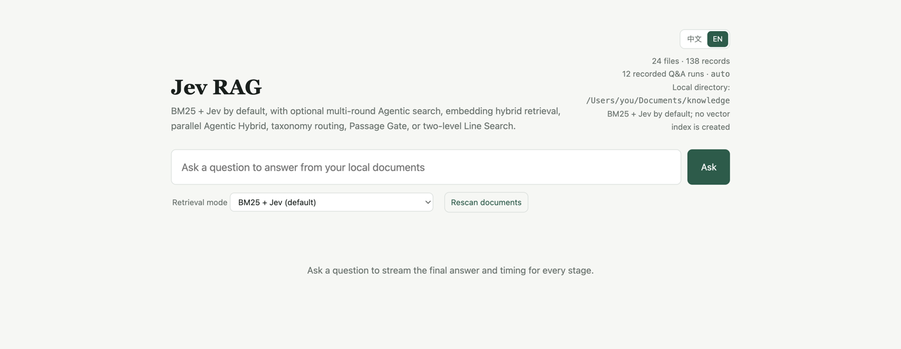

# Jev RAG

**Jev RAG is an open-source local knowledge search engine with seven selectable pipelines: BM25 + Jev by default, agentic lexical search, embedding hybrid retrieval, multi-round Agentic Hybrid, taxonomy-routed hybrid retrieval, a unified Jev Passage Gate, and hierarchical Jev Line Search.**

Use Jev RAG to search a local document folder, rerank candidate passages with
Jev, and stream grounded answers with file citations. The default path is a
vector-free RAG architecture: it requires neither embeddings nor a vector
database. Jev RAG is local-first rather than fully offline because selected
passages are sent to the configured Jev and answer-model providers.

[](https://github.com/aifabrice/jev-rag/actions/workflows/ci.yml)
[](https://github.com/aifabrice/jev-rag/releases)
[](https://www.python.org/)
[](LICENSE)
[Listed in Awesome Jev](https://github.com/yibie/awesome-jev)

**New here?** [Try the no-key demo](#try-local-search-without-an-api-key) · [Star on GitHub](https://github.com/aifabrice/jev-rag/stargazers) · [Fork the project](https://github.com/aifabrice/jev-rag/fork) · [Contribute](CONTRIBUTING.md)

[简体中文](README.zh-CN.md) · [Seven-pipeline field report](docs/JEV_RAG_SEVEN_PIPELINES.md) · [Architecture](docs/ARCHITECTURE.md) · [Security](SECURITY.md) · [Contributing](CONTRIBUTING.md)

**[Project website and interactive benchmark →](https://aifabrice.github.io/jev-rag/)**
· [How to use Jev for RAG](https://aifabrice.github.io/jev-rag/how-to-use-jev-for-rag.html)
· [323-query BM25 + Jev benchmark](https://aifabrice.github.io/jev-rag/bm25-jev-reranking-benchmark.html)
· [Project identity](https://aifabrice.github.io/jev-rag/jevrag.html)
· [Evidence-backed FAQ](https://aifabrice.github.io/jev-rag/faq.html)
· [Machine-readable project facts](https://aifabrice.github.io/jev-rag/llms.txt)
· [Cite Jev RAG](CITATION.cff)



## Try local search without an API key

Start with the public documents included in this repository. This demo needs
only Python 3.9+ with SQLite FTS5: no package install, API key, embeddings, or
model request. It indexes only `./docs`, not your personal Documents folder.

```bash
git clone https://github.com/aifabrice/jev-rag.git
cd jev-rag
python3 local_kb.py --documents ./docs --db .knowledge/quickstart.db index
python3 local_kb.py --documents ./docs --db .knowledge/quickstart.db search 'retrieval' --no-jev
```

Expect ranked passages with source paths and retrieval timing. This is the
**BM25-only baseline**, not Jev reranking or a generated answer. Keep the same
`--documents` and `--db` on both commands; the index is isolated from your
normal knowledge base. To try the full pipeline, continue below.

## Run it locally

```bash
git clone https://github.com/aifabrice/jev-rag.git
cd jev-rag
python3 -m venv .venv
source .venv/bin/activate
python -m pip install -e '.[documents]'
cp .env.example .env  # add OPENROUTER_API_KEY
jev-rag serve
```

Open <http://127.0.0.1:8765>. Jev RAG discovers `~/Documents` by default,
builds the local BM25 index, and opens the English/Chinese search interface.
Use `--documents /absolute/path` to point it at another folder.

**Why try it:** the default path needs no embeddings or vector database; all
seven retrieval pipelines are selectable in the same UI; and the repository
publishes quality, latency, cost, and negative benchmark results instead of a
single best score.

If the reproducible results or local-first approach are useful to you, [star
Jev RAG on GitHub](https://github.com/aifabrice/jev-rag/stargazers) so other
developers can find the project.

## Install the v0.4.0 release

For a reproducible checkout of the current release, pin the tag before creating
the environment:

```bash
git clone --branch v0.4.0 --depth 1 https://github.com/aifabrice/jev-rag.git
cd jev-rag
python3 -m venv .venv
source .venv/bin/activate
python -m pip install --upgrade pip
python -m pip install -e '.[documents]'
```

Add `.[documents,embeddings]` only when you want the optional hybrid and
taxonomy paths. The default BM25 + Jev path does not require embeddings or a
vector database. Configure `OPENROUTER_API_KEY` in `.env` for the full
answering flow, and add `TYPESAFE_API_KEY` only when using direct Jev access.

## Public benchmark

Complete BEIR NFCorpus test split: 3,633 documents and 323 queries. All rows
use the same corpus, queries, qrels, and metric implementation; candidate-pool
sizes and remote stages are shown explicitly.

| Pipeline | nDCG@10 | MRR@10 | Recall@10 | Median latency | p95 latency |
| --- | ---: | ---: | ---: | ---: | ---: |
| BM25 top 30 | 0.305654 | 0.512697 | 0.147309 | 1.27 ms | 6.08 ms |
| BM25 top 30 + Jev | 0.353235 | 0.585817 | 0.158667 | 1.37 s | 4.34 s |
| BM25 top 50 + Jev | 0.362468 | 0.593023 | 0.164474 | 1.39 s | 2.35 s |
| Two-level Jev Line Search (60 finalists) | 0.366280 | **0.657660** | 0.169397 | 11.74 s* | 35.75 s* |
| Hybrid top 50 + Unified Passage Gate | 0.376298 | 0.618043 | 0.166977 | 1.56 s* | 17.47 s* |
| Agentic lexical top 50 | 0.380168 | 0.597940 | 0.185464 | 3.85 s | 5.45 s |
| BM25 top 50 + Embedding top 50 + RRF | 0.396712 | 0.632089 | 0.193977 | 2.33 s | 2.58 s |
| Multi-round Agentic Hybrid top 50 | 0.424145 | 0.637722 | 0.206303 | 6.99 s* | 24.39 s* |
| **Agentic lexical top 50 + Jev** | **0.430969** | **0.644041** | **0.204138** | 6.01 s | 8.69 s |
| Hybrid top 50 + Jev | 0.444327 | **0.654583** | 0.214907 | 3.89 s | 5.67 s |
| **Agentic Hybrid + Jev/retrieval rank fusion** | **0.450750** | **0.652606** | **0.220885** | 6.14 s | 9.35 s |
| **Agentic Hybrid high-recall top 200 + Jev (batch 100)** | **0.466171** | **0.669516** | **0.228912** | 6.52 s | 7.90 s |

Latency covers retrieval and reranking, not one-time corpus indexing or final
answer generation. The ordinary shortlist rows now use one unified 10-query cold
audit: result, planner, and query-embedding caches were disabled, while the corpus
index and corpus embeddings were preloaded. The asterisked Line Search, Passage
Gate, and multi-round Agentic Hybrid rows are historical measurements on a
different protocol and are retained for context, not direct comparison. See
[`nfcorpus-pipeline-latency.json`](benchmarks/nfcorpus-pipeline-latency.json) and the
[`latency audit summary`](benchmarks/nfcorpus-pipeline-latency-audit10-summary.json)
for provenance. Provider latency can change substantially over time.

Line Search achieved the strongest first-hit behavior (`nDCG@1=0.554180`),
but lower multi-document ranking quality and recall than Agentic or Hybrid.
Its full-corpus cold provider cost was $4.553288, so it is an experimental
deep-search path rather than the default.

The unified Passage Gate is a deliberately disclosed negative result: with the
cookbook-inspired fixed thresholds it excluded 13,631 of 16,150 candidates
(84.4%) and scored below both bare Hybrid (`0.396712`) and Hybrid + Jev
(`0.444327`) at nDCG@10. It remains available for experiments that value
prompt-injection screening and query-premise checks, but it is not the default
quality path.

Taxonomy and the pre-fusion Agentic Hybrid order remain documented in the full
report, but are omitted from this headline table because they sit in the same
`0.44-0.45` band without a useful new operating point. The table keeps ordinary
Hybrid as the representative reference and the best measured pipeline.

The highest measured operating point is the high-recall Agentic Hybrid variant:
BM25 and embedding retrieval both reach 200 candidates, then Jev reranks them
in batches of 100 and applies the same dev-selected local RRF after Jev (Jev
rank weight `1.0`, retrieval rank weight `0.25`). It reached `0.466171` test
nDCG@10, `0.669516` MRR@10, and `0.228912` Recall@10. The earlier full run recorded 3.05 s median and 4.24 s p95, but that run
was cache-dominated and is retained as a quality-run observation. Under the
comparable cold audit, the same top-200 configuration measured 6.52 s median
and 7.90 s p95, with `$1.421625` provider cost for the quality run.

This is a benchmark operating point rather than a new UI pipeline. The former
best run used 50 candidates and Jev batches of 10; the high-recall run uses
200 candidates and batches of 100 to keep the full test practical. The complete
quality delta should therefore be attributed to this configuration, not to
candidate depth alone.

### MTEB NFCorpus context (snapshot: 2026-11-01)

MTEB means **Massive Text Embedding Benchmark**. The relevant public task is
[MTEB NFCorpus](https://leaderboard.mteb.org/tasks/NFCorpus), a Retrieval task
whose main metric is `nDCG@10`; the project evaluates the complete BEIR
NFCorpus test split and uses the same metric name. The public task snapshot
contained 258 visible model rows. Its top three scores were `0.557450`,
`0.469900`, and `0.449650` (the read-only [scores snapshot](https://mteb-leaderboard-backend.hf.space/v1/tasks/NFCorpus/scores)
is provided for reproducibility).

If this project's high-recall Agentic Hybrid score (`0.466171`) were inserted
into that snapshot by numeric value, only two visible scores would be higher,
so it would land at a **hypothetical #3 of 259**. This is a numerical
comparison, **not an official MTEB Top 3 or MTEB rank**. Jev RAG is a
multi-stage BM25 + embedding retrieval + Jev reranking + local rank-fusion
pipeline, not a single embedding model; this run is project-run, depends on
remote providers, and has not been submitted or validated through the MTEB
submission process. The leaderboard can also change, so keep the claim tied to
the dated snapshot rather than presenting it as a permanent rank.

[Full results, exact configuration, cost, caveats, and reproduction commands](benchmarks/NFCORPUS_RESULTS.md)
· [Machine-readable Agentic summary](benchmarks/nfcorpus-agentic-summary.json)
· [Machine-readable Line Search summary](benchmarks/nfcorpus-line-search-summary.json)
· [Machine-readable Passage Gate summary](benchmarks/nfcorpus-passage-gate-summary.json)
· [Machine-readable Taxonomy summary](benchmarks/nfcorpus-taxonomy-summary.json)
· [Machine-readable Agentic Hybrid summary](benchmarks/nfcorpus-agentic-hybrid-summary.json)
· [Machine-readable high-recall Agentic Hybrid summary](benchmarks/nfcorpus-agentic-hybrid-top200-summary.json)

The repository also includes a reproducible, cached **development-set
learning-to-rank experiment**. It learns a transparent pairwise linear
combination of existing BM25, embedding, Agentic, and Jev rank signals without
new provider calls. On NFCorpus it reached `0.449055` nDCG@10 versus the
current `0.450750` baseline, so it is documented as an experimental negative
result rather than advertised as a quality improvement. See
[`docs/LEARNING_TO_RANK.md`](docs/LEARNING_TO_RANK.md) and
[`scripts/benchmark_ltr.py`](scripts/benchmark_ltr.py).

A second no-cost experiment tests pseudo-relevance feedback: extract terms
from the first-pass candidates, run a focused BM25 query, and fuse the result.
It improved retrieval-only nDCG@10 by `+0.004816`, but a 10-query Jev pilot
fell from `0.476183` to `0.463357`; it is therefore not enabled by default.
See [`docs/PSEUDO_RELEVANCE.md`](docs/PSEUDO_RELEVANCE.md),
[`scripts/benchmark_prf.py`](scripts/benchmark_prf.py), and
[`scripts/pilot_prf_jev.py`](scripts/pilot_prf_jev.py).

```text
default: local files -> SQLite BM25 ----------------------> Jev -> MiniMax
agentic: local files -> MiniMax plans -> multi-BM25/RRF --> Jev -> MiniMax
hybrid:  local files -> BM25 + OpenRouter embeddings/RRF -> Jev -> MiniMax
agentic-hybrid: multi-round plans -> multi-BM25 + embedding/RRF -> Jev + retrieval prior -> MiniMax
high-recall benchmark: same Agentic Hybrid path -> top 200 -> Jev batches of 100
taxonomy: local files -> corpus taxonomy -> Hybrid top 50 + routed extras -> Jev -> MiniMax
gate:    local files -> BM25 + embeddings/RRF -> unified Jev Gate -> MiniMax
line:    local files -> parallel Jev Choice windows -> global Choice -> MiniMax
```

Jev RAG indexes a local folder and defaults to vector-free SQLite FTS5/BM25.
The web UI and CLI expose seven modes. Agentic mode defaults to two rounds of
model-planned local lexical searches, accepts any positive round count, and
fuses every round before Jev without an embedding index. Hybrid mode fuses BM25
and embedding rankings before Jev. No
vector database is required: the optional normalized embedding matrix is cached
locally. Passage Gate replaces ordinary reranking with four simultaneous Jev
judgments per candidate and routes evidence into include, conflicting, or
exclude groups. Line Search partitions the full index into windows of at most 255,
searches every window with Jev Choice + Noul, and globally re-ranks the window
finalists with a second Choice request. The UI streams cited answers and reports
each pipeline stage's latency.

Agentic Hybrid keeps those two planning rounds, runs their multi-query BM25
branch alongside an original-query embedding lookup, then fuses the Agentic and
dense rankings with weighted RRF (`0.65:1.0`) before the same Jev reranker.
The Agentic Hybrid path then blends the Jev rank with the original retrieval
rank at `1.0:0.25`; this post-rerank step is local and makes no provider call.

Taxonomy mode deterministically clusters the cached corpus embeddings into two
levels, routes each query to four leaf nodes, and appends up to 20 unique routed
candidates to the unchanged Hybrid top 50 before the ordinary Jev stage. The
tree is built from corpus documents only; benchmark queries and qrels are not
used.

> Status: alpha. The software is usable locally, but APIs and storage schemas may change before 1.0.

## Why this project

- Vector-free BM25 + Jev remains the default; no embedding setup is required.
- Optional multi-round Agentic Search + Jev improves lexical recall without building embeddings.
- Optional BM25 + Embedding reciprocal-rank fusion before the same Jev stage.
- Optional multi-round Agentic BM25 + original-query embedding fusion before Jev.
  A dev-selected local Jev/retrieval rank fusion improves the measured final
  order without another provider call, but planning still adds substantial
  latency.
- Optional two-level corpus taxonomy for query routing and Hybrid candidate
  expansion. The public benchmark improved pool recall but not nDCG@10.
- Optional Hybrid + Unified Jev Passage Gate for relevance, answer-evidence,
  contradiction, and prompt-injection routing. The fixed profile is
  experimental and did not improve NFCorpus nDCG@10.
- Optional two-level Jev Line Search with a structural capacity of 65,025
  indexed passages, without BM25 or embeddings. Practical cost and latency grow
  with corpus size.
- No vector database or GPU; hybrid vectors are cached in `.knowledge/`.
- Local incremental indexing for Markdown, text, HTML, JSON, CSV, YAML, DOCX, and PDF.
- Chinese-aware lexical tokenization using CJK bigrams.
- BM25 candidate retrieval followed by Jev evidence scoring.
- Automatic Jev batching for long candidate lists.
- Optional relevance threshold and explicit no-evidence behavior.
- Streaming grounded answers with numbered file citations.
- SQLite caches and per-run latency, usage, and cost records.
- Standard-library core; `pypdf` is optional for PDF extraction.

## How it differs from vector RAG

| | Default | Agentic | Hybrid | Agentic Hybrid | Taxonomy | Hybrid Gate | Line Search |
|---|---|---|---|---|---|---|---|
| First stage | SQLite FTS5/BM25 | Planned multi-BM25 + RRF | BM25 + embedding RRF | Planned multi-BM25 + embedding RRF | Hybrid top 50 + taxonomy extras | BM25 + embedding RRF | Parallel Jev Choice windows |
| Second stage | Jev reranking | Jev reranking | Jev reranking | Jev reranking | Jev reranking | Unified four-question Jev gate | Global Jev Choice |
| Vector index | No | No | Local cached matrix | Local cached matrix | Local cached matrix + tree | Local cached matrix | No |
| Main trade-off | Can miss synonyms | Planner latency/cost | Embedding boundary | Highest measured point estimate; high planner latency | More recall, candidates, and Jev cost | Aggressive filtering; four judgments per passage | Full corpus remotely; highest cost |

This is a deliberate retrieval architecture, not a claim that lexical search always beats embeddings. Measure it on your own documents and questions.

## Non-goals

Jev RAG is not a hosted multi-user service or a guarantee of factual correctness. Jev and the answer model are remote services. Hybrid mode additionally sends document text and queries to the configured OpenRouter embedding model.

## Requirements

- Python 3.9+
- SQLite with FTS5 enabled
- An OpenRouter API key for the default end-to-end path
- Optionally, a TypeSafe API key for direct Jev access
- Optionally, `pypdf` or the system `pdftotext` command for PDFs

## Install

From a source checkout:

```bash
python3 -m venv .venv
source .venv/bin/activate
python -m pip install -e '.[documents]'
# Include the optional hybrid mode:
python -m pip install -e '.[documents,embeddings]'
cp .env.example .env
```

On Windows PowerShell, activate with `.venv\Scripts\Activate.ps1`.

Set at least `OPENROUTER_API_KEY` in `.env` for the default pipeline:

```dotenv
OPENROUTER_API_KEY=
TYPESAFE_API_KEY=
```

Never commit `.env`. If a key is exposed, revoke it immediately; deleting it from the latest commit is not sufficient.

## Quick start

By default, Jev RAG discovers and indexes the current user's `~/Documents`
folder. Start the local search application with:

```bash
jev-rag serve
```

Open <http://127.0.0.1:8765>. The server binds to localhost by default.
Choose **BM25 + Jev** (default), **Agentic Search + Jev**,
**BM25 + Embedding + Jev**, **Multi-round Agentic + BM25 + Embedding + Jev**,
or one of the experimental routing/search modes in the UI.
Startup incrementally updates the local BM25 index. The default mode does not
create embeddings and does not require a vector database.

Without installing the command, the equivalent source commands are:

```bash
python3 local_kb.py index
python3 local_kb.py serve
```

You can also search directly from the CLI:

```bash
jev-rag search 'Which AI products are mentioned in my documents?'
```

To persist a different default folder, set this in `.env`:

```dotenv
JEV_RAG_DOCUMENTS=/absolute/path/to/documents
```

## Index another folder

```bash
jev-rag \
  --documents /absolute/path/to/documents \
  --db .knowledge/documents.db \
  --exclude 'private/**' \
  index --rebuild

jev-rag \
  --documents /absolute/path/to/documents \
  --db .knowledge/documents.db \
  --exclude 'private/**' \
  serve
```

Exclusions are relative glob patterns and may be repeated. Exclude the project directory when indexing one of its parent folders.

## Retrieval and answer defaults

The web application currently uses:

- Document root: auto-discovered `~/Documents`, falling back to `knowledge/`
- Incremental local indexing whenever `serve` starts
- Retrieval mode: `bm25` by default
- BM25 candidates: up to 30 passages
- Hybrid mode: BM25 top 50 + embedding top 50, RRF top 50 (`rrf_k=60`)
- Agentic Hybrid mode: two planning rounds with five lexical queries per
  round; multi-query BM25 runs alongside the original-query embedding lookup;
  weighted RRF (`0.65:1.0`) keeps 50 candidates for Jev, then a zero-call
  Jev/retrieval rank fusion (`1.0:0.25`) produces the final order
- Taxonomy mode: preserve Hybrid top 50, route over a cached two-level corpus
  tree, then append up to 20 unique node-local candidates before Jev
- Hybrid Gate mode: the same fused top 50, then one Jev stage asks four `Noul`
  questions per passage and applies fixed relevance/evidence/conflict/injection thresholds
- Agentic mode: two planning rounds, five lexical queries per round, BM25 top 100 per query, RRF top 50
- Line Search mode: up to 255 passages per window, four finalists per window,
  at most 255 windows, and a final global Choice; no additional Jev reranker
- The Line Search path extends TypeSafe's
  [Semantic Find cookbook](https://docs.typesafe.ai/cookbooks/semantic_find)
  with parallel window fan-out and a global reduce stage.
- Agentic planner: `minimax/minimax-m3` through OpenRouter; plans are cached locally
- Embedding model: `openai/text-embedding-3-large` through OpenRouter
- Jev batch size: 10 candidates per request, with batches executed concurrently
- Evidence passed to the answer model: up to 10 passages
- Answer model: `minimax/minimax-m3` through OpenRouter
- Relevance threshold: `0.0` by default, preserving all scored candidates

To require a minimum Jev score and return a local no-evidence response when nothing passes:

```bash
jev-rag serve --threshold 0.20
```

Thresholds are application policy, not proof of relevance. Calibrate them on representative questions and documents.

## Chunking

```bash
# Default: keep short files whole; split long files by headings and paragraphs.
jev-rag index --chunking auto --rebuild

# One searchable record per file.
jev-rag index --chunking none --rebuild

# Always group content into heading-aware passages.
jev-rag index --chunking paragraph --rebuild
```

Very large files should usually be chunked. With `none`, citations identify the file but cannot point precisely to a small passage.

## CLI reference

```bash
# BM25 only; makes no Jev request.
jev-rag search 'query' --no-jev

# Optional hybrid retrieval followed by Jev.
jev-rag search 'query' --retrieval-mode hybrid

# Experimental corpus-taxonomy routing plus Hybrid candidate expansion.
jev-rag search 'query' --retrieval-mode taxonomy

# Hybrid retrieval followed by one unified Jev Passage Gate (experimental).
jev-rag search 'query' --retrieval-mode hybrid-gate

# Agent-planned local lexical searches followed by Jev; no vector index.
jev-rag search 'query' --retrieval-mode agentic

# Multi-round Agentic BM25 plus parallel original-query embedding, then Jev.
jev-rag search 'query' --retrieval-mode agentic-hybrid

# Search every indexed passage with parallel Jev windows, then globally rank finalists.
jev-rag search 'query' --retrieval-mode line-search

# Tune the two hierarchy levels (maximum window size is 255).
jev-rag search 'query' --retrieval-mode line-search \
  --line-search-window-size 255 --line-search-beam 4

# Make hybrid the initial selection in the web UI.
jev-rag serve --retrieval-mode hybrid

# Keep only passages at or above a Jev score.
jev-rag search 'query' --threshold 0.20

# Machine-readable output.
jev-rag search 'query' --json

# Ignore a cached Jev judgment.
jev-rag search 'query' --no-cache

# Inspect the local index.
jev-rag status

# Test provider connectivity without starting the knowledge-base app.
jev-rag-smoke-test --provider openrouter
jev-rag-smoke-test --provider typesafe
jev-rag-smoke-test --dry-run
```

Run `jev-rag --help` and `jev-rag <command> --help` for all options.

## Supported files

`.txt`, `.md`, `.markdown`, `.rst`, `.log`, `.csv`, `.tsv`, `.json`, `.jsonl`, `.yaml`, `.yml`, `.html`, `.htm`, `.docx`, and `.pdf`.

Scanned or image-only PDFs require OCR before indexing. PDF extraction prefers `pypdf`, then falls back to `pdftotext` when available.

## Privacy and security

- Indexes, caches, and answer histories are stored under `.knowledge/` by default.
- BM25 indexing and retrieval stay local.
- Default discovery indexes supported text documents; it does not upload the folder itself.
- File symlinks that resolve outside the selected document root are ignored.
- Hybrid mode sends passage text once for corpus embeddings and sends each query for query embedding; vectors are cached locally.
- Hybrid Gate additionally sends the fused top 50 excerpts to Jev for four
  judgments per passage. Injection filtering is probabilistic, not a complete security boundary.
- Agentic mode sends the query and up to eight first-round snippets to the OpenRouter planner; generated search plans are cached locally.
- Line Search sends a bounded representation of every indexed passage to the
  configured Jev provider in windows, then sends the window finalists once more
  for global ranking. Narrow `--documents` and `--exclude` before using it on
  private files.
- Jev receives the query and candidate passage text.
- OpenRouter receives the query and final evidence passages for answer generation.
- The local HTTP server has no authentication. Do not expose it directly to the public internet.
- Retrieved documents are untrusted input. The answer prompt asks the model to treat them as evidence, but this is not a complete prompt-injection security boundary.

Read [SECURITY.md](SECURITY.md) before using sensitive documents.

## Development

```bash
python -m pip install -e '.[dev,documents]'
python scripts/check_release.py
python -m unittest discover -s tests -v
python -m compileall -q local_kb.py jev_test.py tests
python -m build
python -m twine check dist/*
```

Normal tests do not call paid APIs. Live calls are always explicit.

## Reproducible evaluation

Run the bundled BM25 smoke benchmark without paid API calls:

```bash
python scripts/benchmark.py
```

To compare the same questions after Jev reranking, explicitly opt in to provider calls:

```bash
python scripts/benchmark.py --use-jev --provider openrouter
```

See the [complete NFCorpus result](benchmarks/NFCORPUS_RESULTS.md) and
[Evaluation](docs/EVALUATION.md) for public benchmark reproduction, the JSONL
format, limitations, and instructions for testing a private document collection.

## Community and roadmap

- **Ecosystem listings:** [Awesome Jev](https://github.com/yibie/awesome-jev) and
  [Awesome Jev TypeSafe](https://github.com/valentynkit/awesome-jev-typesafe) both
  include Jev RAG. These are independent community directories, not endorsements.
- Use [Discussions](https://github.com/aifabrice/jev-rag/discussions) for questions, use cases, and design ideas.
- Current design thread: [opt-in local OCR for image-only PDFs](https://github.com/aifabrice/jev-rag/discussions/14).
- Use [Issues](https://github.com/aifabrice/jev-rag/issues) for reproducible bugs and scoped feature requests.
- Follow the [ten-minute first-contribution path](CONTRIBUTING.md#ten-minute-first-contribution) to verify indexing, retrieval, and tests without an API key.
- Good first contributions include OCR adapters, more document loaders, evaluation datasets, provider adapters, and packaging improvements.
- Planned work is tracked in the [issue tracker](https://github.com/aifabrice/jev-rag/issues).

## Project maturity and naming

Other public repositories use similar `jev-rag` names. This project is distinguished by its vector-free BM25 default, optional embedding hybrid retrieval, Jev reranking, local-folder indexing, and MiniMax streaming answer path. It is an independent community project and is not affiliated with or endorsed by TypeSafe AI, OpenRouter, or MiniMax.

## License

[MIT](LICENSE)
